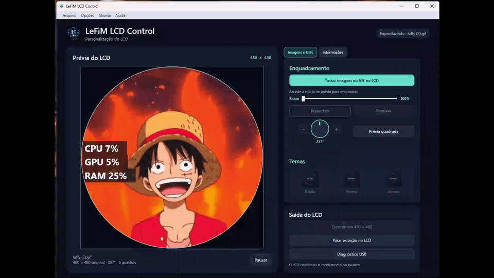

# LeFiM LCD Control

I built LeFiM LCD Control to show images, GIFs, and system readings on my PC’s 480 × 480 USB display. On Windows, you can adjust the framing in the preview and send the result to the LCD.

[Português](README.md) · [Downloads](https://github.com/alefcferreira/lefim-lcd-control/releases) · [Report an issue](https://github.com/alefcferreira/lefim-lcd-control/issues/new)



## Compatibility

- Windows 11 x64 with .NET Framework 4.8.
- Tested hardware: 480 × 480 USB LCD using WinUSB, VID `2A55`, PID `9990`, revision `0200`. Check your panel resolution too, as variants exist.
- Sensor availability depends on hardware and drivers. For additional sensor readings, extract [Libre Hardware Monitor](https://github.com/LibreHardwareMonitor/LibreHardwareMonitor/releases) to `Downloads\LibreHardwareMonitor`. The setup offers an optional [PawnIO](https://pawnio.eu/) download.

[View the tested display on AliExpress](https://s.click.aliexpress.com/e/_c4cb1ATn) · **Ad (affiliate link)**

## Install and use

1. Download the setup executable or portable ZIP from [Releases](https://github.com/alefcferreira/lefim-lcd-control/releases). To use the ZIP, extract it and run `LeFiM-LCD-Control.exe`.
2. Close any other software using the LCD. Import an image or GIF and adjust its zoom, position, and rotation in the preview.
3. Select **Send to LCD**. Keep the app running during playback. Closing the window hides it in the system tray.
4. Open the information tab to add an overlay with readings such as temperature, RAM usage, or the clock.

## Build

On x64 Windows with .NET Framework 4.8, open PowerShell in the repository root:

```powershell
.\Compilar.ps1
.\Compilar-Instalador.ps1
```

The first command builds `LeFiM-LCD-Control.exe`. The second packages it as `LeFiM-LCD-Control-Setup.exe`. Both scripts use the Windows .NET Framework compiler.

When reporting a problem, include the app version, Windows version, panel resolution and VID/PID, steps to reproduce, and the USB diagnostics message if available.

## Support the project

If LeFiM LCD Control helped you, you can support its development with an optional contribution. Thanks for using the app!

In the app, open **Donate** and choose how you’d like to contribute.

[Support on Ko-fi](https://ko-fi.com/alefcferreira) · [Support via Mercado Pago](https://link.mercadopago.com.br/lefimscripts)
