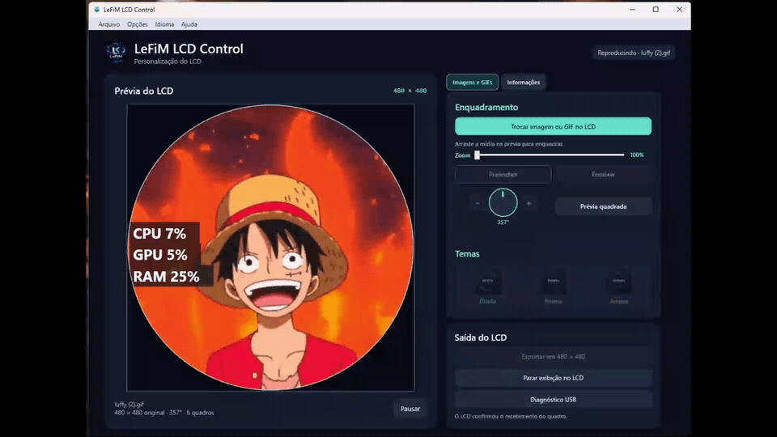

# LeFiM LCD Control

Criei o LeFiM LCD Control para usar a telinha USB de 480 × 480 do meu PC com imagens, GIFs e informações do sistema. No Windows, você ajusta o enquadramento na prévia e envia o resultado para o LCD.

[English](README.en.md) · [Downloads](https://github.com/alefcferreira/lefim-lcd-control/releases) · [Reportar um problema](https://github.com/alefcferreira/lefim-lcd-control/issues/new)



## Compatibilidade

- Windows 11 x64 com .NET Framework 4.8.
- Hardware testado: LCD USB de 480 × 480 com WinUSB, VID `2A55`, PID `9990`, revisão `0200`. Confirme também a resolução do painel, pois há variantes.
- Os sensores disponíveis dependem do hardware e do driver. Para ampliar a leitura de sensores, extraia o [Libre Hardware Monitor](https://github.com/LibreHardwareMonitor/LibreHardwareMonitor/releases) em `Downloads\LibreHardwareMonitor`. O instalador oferece o download opcional do [PawnIO](https://pawnio.eu/).

[Ver a telinha testada no AliExpress](https://s.click.aliexpress.com/e/_c4cb1ATn) · **Publicidade (link de afiliado)**

## Instalação e uso

1. Em [Releases](https://github.com/alefcferreira/lefim-lcd-control/releases), baixe o instalador ou o ZIP portátil. Para usar o ZIP, extraia-o e abra `LeFiM-LCD-Control.exe`.
2. Feche o software que estiver usando o LCD. Importe uma imagem ou GIF e ajuste zoom, posição e rotação na prévia.
3. Clique em **Enviar ao LCD**. Mantenha o aplicativo aberto durante a reprodução. O botão de fechar a janela a oculta na bandeja.
4. Para personalizar a sobreposição, abra **Informações** e selecione as leituras que quer exibir, como temperatura, uso de RAM ou relógio.

## Compilação

Em um Windows x64 com .NET Framework 4.8, abra o PowerShell na raiz do repositório:

```powershell
.\Compilar.ps1
.\Compilar-Instalador.ps1
```

O primeiro comando gera `LeFiM-LCD-Control.exe`. O segundo empacota esse executável em `LeFiM-LCD-Control-Setup.exe`. A compilação usa o compilador do .NET Framework do Windows.

Ao abrir uma issue, inclua a versão do aplicativo, a versão do Windows, a resolução e o VID/PID do painel, os passos para reproduzir e a mensagem de **Diagnóstico USB**, quando houver.

## Apoie o projeto

Se o LeFiM LCD Control te ajudou, você pode apoiar seu desenvolvimento com uma contribuição voluntária. Obrigado por usar o programa!

No aplicativo, abra **Doações** e escolha uma das opções de apoio.

[Apoie pelo Ko-fi](https://ko-fi.com/alefcferreira) · [Apoie pelo Mercado Pago](https://link.mercadopago.com.br/lefimscripts)
